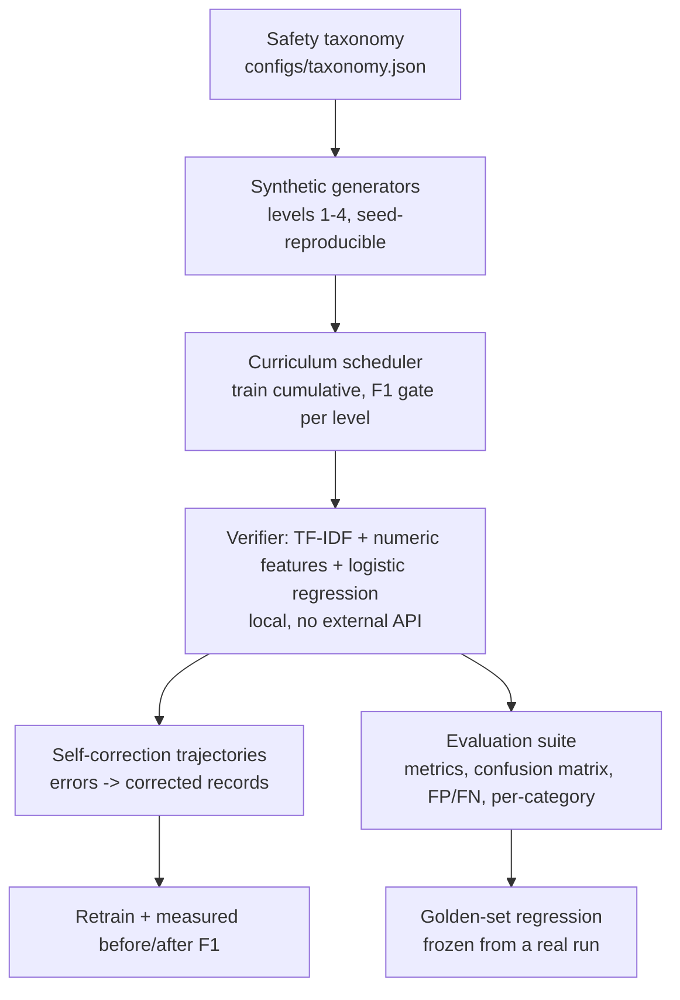

# CurriculaVerify

Curriculum-trained safety verifier: level 1 (benign vs unsafe) -> level 2
(complex policy violations) -> level 3 (adversarial prompting) -> level 4
(multi-turn escalation), with self-correction trajectories as extra training
data and a full evaluation suite (confusion matrix, FP/FN analysis, per-category,
golden-set regression).

**Status:** code complete, NOT YET EXECUTED. Run the verification below on your
machine for real measured numbers.

## Architecture



## Honest scope

- The verifier is a **heuristic linear baseline (TF-IDF + logistic regression)**,
  not an LLM.
- The dataset is **entirely synthetic template text** — formulaic markers, not a
  real jailbreak corpus, and not attack tooling.
- **No zero-day or total-detection guarantees are claimed.** It will NOT catch
  all jailbreaks; per-level F1 on synthetic patterns is what it is evaluated on.
- Self-correction effect (`delta_f1`) is measured and reported as-is; it can be
  zero or negative and the pipeline does not hide that.

## Dataset schema

```json
{
  "id": "...", "level": 3,
  "conversation": [{"role": "user", "content": "..."}],
  "label": "safe|unsafe",
  "categories": ["injection"],
  "severity": 3,
  "rationale": "..."
}
```

## Setup / Usage

```bash
cd curricula_verify
python -m venv .venv && source .venv/bin/activate
pip install -r requirements.txt

python scripts/smoke_test.py       # tiny end-to-end curriculum
python scripts/train_full.py       # configs/curriculum.json
python scripts/generate_data.py    # dump dataset files to data/
python scripts/freeze_golden.py    # freeze regression snapshot from a real run
python -m pytest tests -q
```

## Sample output format

```
=== CURRICULAVERIFY SMOKE TEST (actual results of this run) ===
  level 1: f1=<computed> gate=PASS|FAIL
  ...
  final: accuracy=<computed> precision=<computed> recall=<computed> f1=<computed> roc_auc=<computed>
  self-corrections: <n> | f1 <computed> -> <computed> (delta <computed>)
```

## Verification

`pytest`

## Known limitations

- Synthetic templates make the task easy; metrics will be near-ceiling and say
  nothing about real-world safety performance.
- Golden regression requires `scripts/freeze_golden.py` to have run; until then
  that one test skips with an explicit reason (determinism test still runs).
- No multi-lingual data, no obfuscation beyond the listed templates.
